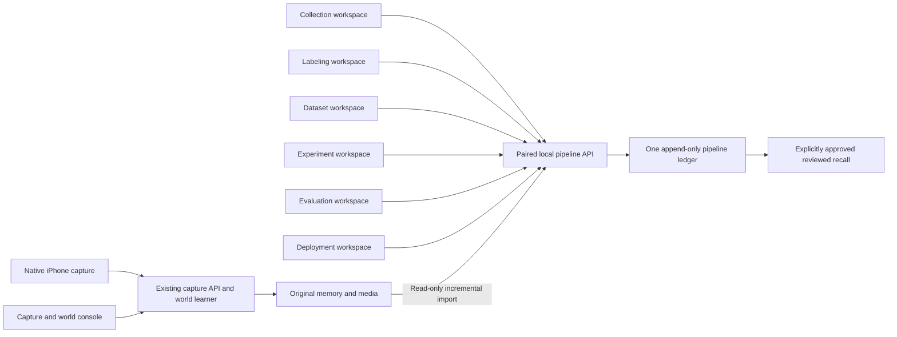

# Grounded Memory applications

Grounded Memory has six independently addressable browser workspaces, one overview, and the existing capture/world console. They share the same paired local backend and pipeline ledger. There are no additional installs, background daemons, or synchronized copies of memory.

## Open the applications

From the project root, run:

```sh
make dev
```

Open [Grounded Memory](http://localhost:3100) and enter the terminal's pairing code. Use the same hostname for every workspace so the pairing cookie is shared. Each link can be bookmarked or opened in its own window. The applications run locally; there are no separately packaged native Mac `.app` bundles.

| Workspace | Address | Main responsibility |
|---|---|---|
| Overview | [localhost:3100](http://localhost:3100) | Real counts, suggested next stage, direct navigation |
| Collection | [/collection](http://localhost:3100/collection) | Saved-input import, source switches, notes, provenance, history, errors and ledger storage |
| Labeling | [/labeling](http://localhost:3100/labeling) | Focused review queue, suggestions, human decisions, corrections, skip/flag and exclusions |
| Datasets | [/datasets](http://localhost:3100/datasets) | Select reviewed evidence, group related sources, reserve splits, write independent questions and prepare versions |
| Experiments | [/experiments](http://localhost:3100/experiments) | Freeze deterministic retrieval candidates with dataset and code identity |
| Evaluation | [/evaluation](http://localhost:3100/evaluation) | Compare with a fixed baseline, inspect missed/incorrect evidence, return failures to Labeling |
| Deployment | [/deployment](http://localhost:3100/deployment) | Readiness, explicit promotion, health, evidence-backed recall and explicit rollback |
| Capture & world learning | [/capture](http://localhost:3100/capture) | Existing camera/file capture, sessions, teacher dialogue, beliefs, expectations and world learning |

The original console and its existing pipeline panel are retained at `/capture`. Existing APIs, CLI commands, native iPhone capture and world-learning plans remain available.

!Current overview with two starting goals and step-by-step help

This is an actual browser capture using disposable validation data. Counts reflect that temporary workflow, not field accuracy. To update it, use a disposable `GM_DATA_DIR`, pair a separate test browser with the temporary backend, and capture the overview as `docs/images/guided-overview.jpg`. Keep private source evidence out of screenshots. The older `labeling-workspace.jpg` records the interface before first-use guidance was added.

## Start with your goal

### Observe and teach

1. From Overview, choose **Start observing**. Choose **Import video**, upload a recording, then **Begin observation**; or choose **Live camera** and **Connect phone / webcam**. Native iPhone setup is in [PHONE](PHONE.md).
2. Observe and answer a question in your own words. Leaving the place unknown does not block observation. **Later** keeps a question for another time without stopping capture.
3. Stop live recording when finished and wait for saving. Imported videos finish at the end of processing. Inspect beliefs and their evidence in **My understanding of the world**.
4. If you want human-reviewed recall, open **Collection**, choose **Collect saved inputs now**, inspect what arrived, and open **Labeling**. This import is separate from live learning.

### Review and test memories

1. Choose **Start with Collection**, add a short note about something you observed, and choose **Review this note**. Alternatively, import saved capture inputs.
2. In Labeling, inspect the original, correct the memory, supply a stable fact name, choose current/historical/uncertain/excluded, and **Save human review**. Skip and Flag do not confirm evidence.
3. Open Datasets. Select eligible evidence, group it, choose splits, write independent questions with expected evidence, name the dataset, and prepare a version. **Validation** is for choosing settings. **Held-out** final and regression questions stay out of tuning. A single-note validation dataset is useful for learning the interface, but cannot qualify for deployment.
4. Choose **Use this dataset in Experiments**. That exact version is selected. Keep the defaults or expand optional search limits, then **Freeze candidate**. A candidate is a saved search configuration, not a trained model or an active deployment.
5. Choose **Validate this candidate**, run validation, and inspect matches and failures. Once you have chosen settings, freeze that choice and run both **Final evaluation** and **Regression** on independent held-out questions. If those questions are missing, prepare a new dataset version first.
6. Follow **Check this candidate’s deployment readiness**. The candidate stays selected. Readiness explains missing suites, category coverage, failing results, or stale evidence; it changes nothing. Both final suites must cover accuracy, retrieval, temporal, contradiction, consolidation, grounding, and privacy and satisfy the existing promotion checks.
7. Only a ready candidate exposes approval. Read and select it, then explicitly deploy. Try approved recall and inspect its cited evidence. **Reviewed recall** searches approved reviewed memories; it does not replace live learning or perception.

### Help, notifications, and handoffs

- **Your steps** shows what a screen needs, what to do, what it produces, and its completion point. The workflow map highlights the current screen and links to every stage.
- **Hide steps** and **Dismiss tip** are optional. **Help & steps** reopens steps; **Show tips again** restores all guidance. Browser preferences use `gm.guidance.v1` in local storage; iPhone preferences remain on that phone. Blocked storage leaves help usable for the current visit. No account synchronization or evidence is stored in these preferences.
- Confirmations remain until dismissed, replaced, or you leave/reload the page. Links offer the next action without moving you automatically. Loading errors offer **Retry loading**; failed actions explain how to correct and retry the original action. Operational errors are separate from dismissible help.
- Optional settings, history, and shortcuts expand on demand. Review decisions, held-out acknowledgments, and activation/rollback approvals remain explicit and visible when applicable. Disabled main actions explain the missing prerequisite; an active request shows a working message.
- Existing record and evaluation links remain supported. `/experiments?dataset=…` and `/deployment?candidate=…` carry exact selections. Linked artifacts resolve directly, including items older than the newest 100 in selectors. Missing/wrong-kind links explain the problem; users can choose another item. Visiting a link never submits, evaluates, or approves anything.
- The shared guidance model is presentation-only; the same backend APIs and ledger remain authoritative. No new service, dependency, migration, or automatic promotion was introduced.

## Why this architecture

The reference investigation covered Chew Sense's current `ChewSense/README.md`, `docs/ARCHITECTURE.md`, `docs/GUIDED_LOOP.md`, and `apps/review-macos/README.md`, alongside Grounded Memory's pipeline, API, capture console, world-model contracts, setup commands and existing tests. Chew Sense sources were read only.

| Reference pattern | Adaptation here |
|---|---|
| Collect owns capture; Review owns human decisions; Live owns inference | Separate workspaces, with original capture/world learning retained as its own surface |
| “Up next” and visible completion state | Overview with measured counts, focused labeling queue, explicit empty states and next-stage links |
| Immutable candidates and review lineage | Existing append-only source/annotation/dataset contracts remain authoritative; queue triage has separate history |
| Assisted proposals distinct from verified labels | Local metadata/text suggestions remain unreviewed until explicit human save |
| Shared service and one workspace source of truth | One paired API and SQLite ledger; no copied databases between applications |
| Locked evaluation and explicit registry promotion | Persistent split ownership, frozen candidates, shared readiness/promotion checks and append-only rollback |
| Training dashboard, failure review, processing controls | Search configuration forms and result views; browser-scoped automatic import with pause |

Chew Sense's native video/IMU timeline, chew-cycle categories, personalized motion training and wearable deployment are specialized to that project. Grounded Memory's diverse evidence benefits from text/fact/validity review rather than copying those annotation types or building an unvalidated training stack. The source describes Chew Sense's capabilities; its hardware claims were not independently retested here.

Separate native Mac shells would add packaging, lifecycle and update work without adding data capability today. Separate web routes provide independent entry points and task identity while reusing the mature local backend and native phone. A native shell can be reconsidered if window management or background capture becomes the actual bottleneck.



The browser owns presentation and temporary form state. `pipeline/workspaces.py` owns filtered read models, triage, saved source preferences, grouping and read-only readiness. Existing stage modules still own annotation validity, leakage prevention, evaluation and deployment decisions. `routes.py` is transport only. No world-domain decisions moved into the UI.

## Daily workflow

### Collection

Choose **Collect saved inputs now** for a bounded 500-record import. Repeat when more remain. Source switches persist and affect the HTTP import operation; pausing or switching a source never disables a physical sensor or deletes evidence. Disabled sources retain their checkpoints and catch up when re-enabled. CLI `import` keeps its existing all-source behavior.

**Start automatic collection** checks every ten seconds while Collection stays open. Closing/navigating away stops scheduling; pausing allows the current request to finish. It is not an always-running service, and sleeping/background browsers may delay checks. Errors pause automatic collection. Normal opening/refreshing is read-only.

**Collect a note** preserves its source time and optional session/document grouping, then makes it available to Labeling. Notes are unreviewed until explicitly reviewed. The retry uses the same note identity and timestamp; editing the form creates a new intake identity. For live camera/microphone capture or file upload, use the existing linked capture console or native phone. Capture interruptions remain in session history and phone outbox, separate from pipeline failures.

Storage is explicitly **pipeline ledger storage**, including SQLite sidecars. Media is not copied or counted here. Historical errors remain visible even after a successful retry.

### Labeling

Queue filters run on the backend **before pagination**, using the latest annotation and triage revision. Choose awaiting review, flagged, skipped, reviewed, excluded or all. Search, source filters and ordering help narrow the queue. Priority puts explicitly flagged records first, then contested annotations; it is not a model confidence score.

Open a record to inspect the immutable source and obtain a deterministic text/metadata suggestion. Original image/audio references are displayed when available as retained local assets; some sensor envelopes contain only structured features or source-recording references, available under provenance and in capture. No external model is called. Human-confirmed, suggested and unreviewed records have distinct badges.

Write the reviewed memory and a stable fact/relationship name such as `toolbox:location`. Shared fact names support conflict inspection and prevent splitting related evidence across tuning and evaluation. Choose current, historical, uncertain/conflicting, or irrelevant/unusable. Optional UTC validity bounds support time-aware recall; notes can describe source reliability without inventing a calibrated reliability weight.

Save explicitly to confirm. The editor preserves the original and prior labels, rejects stale revisions, and warns before discarding unsaved edits. **Reload latest revision** resolves an edit conflict after inspection. Corrections invalidate downstream datasets that pinned the older label.

**Skip** persists for later without confirming a label. **Flag** records a problem for focused inspection. Safe batch operations only skip/flag; there is no blind bulk confirmation. Triage does not silently change truth or invalidate an existing deployment; review/exclusion is the explicit integrity action. Reviewed records returned from Evaluation appear in **Flagged**. Source exclusion blocks datasets and recall; it is reversible policy, not deletion.

Shortcuts outside fields/buttons: **J / N** next, **P** previous, **S** save, **K** skip, **F** flag. Navigation shortcuts operate on the loaded page. Drafts are held in the open editor, not persisted across application quits.

### Datasets

Select eligible records across pages. The backend groups connected sources, conversations, normalized exact text, payload hashes and fact keys. Existing split reservations stay locked. New groups default to validation; small datasets are not automatically scattered into meaningless train/test partitions.

Choose training/development, validation/tuning, final evaluation or regression for each independent group. Add separately reviewed questions with expected evidence (or no evidence for unanswerable cases), relevant categories, expected uncertainty and, where needed, time/duplicate/source-access constraints. Use the real conversation/document identity for question provenance. Questions with no expected evidence require explicit provenance. Preparing freezes exact labels, source fingerprints, evaluation time and cases; repeated preparation of unchanged inputs in the same open form is idempotent. Corrections create new versions.

The existing preparation gate rejects leakage and reports duplicates/possible conflicts rather than deleting them. Declared lineage and exact checks cannot discover all paraphrases or hidden relationships. Review those manually. Excluded and model-derived sources never become independent evidence simply because someone reviewed them.

### Experiments and evaluation

Freeze **query coverage** or **word overlap**, maximum answers and minimum match score against a prepared dataset. This is deterministic retrieval experimentation, **not neural model training**. Scores are lexical similarity, not calibrated certainty.

Use validation to compare choices. Freeze the choice before final test/regression evaluation; the UI requires that acknowledgment for final suites. Human behavior still determines whether published final answers influence future tuning; the software enforces split identity, not a person's knowledge. Never move final facts into development or create a fresh ledger to bypass reservations.

Results show precision/relevance, recall/missed evidence, exact correctness, category scores and per-question failures. Final evaluations also check the full deployment corpus. History shows candidate identity and baseline comparisons. Sending a failure to Labeling flags its evidence without changing its annotation or split. A real-world accuracy estimate still needs independently reviewed real questions.

### Deployment and recovery

**Check readiness** is read-only and calls the same validation used by actual promotion. Both test and regression suites must cover the seven existing categories, pass every curated case against split and full corpora, and not regress against the fixed baseline. A single validation question is intentionally insufficient.

Check the explicit approval box to activate a passing candidate. The page shows the active configuration, dataset, synthetic status and deployment health. Promotion affects **supplementary reviewed-memory recall only**, never the world learner or perception models. Rollback requires its own explicit approval and rechecks code/source compatibility.

A label correction, source exclusion or backend-code change can make a deployment unavailable. Reprepare as appropriate, create a new candidate and reevaluate; do not silently run stale evidence. History remains inspectable. Readiness compares the fixed baseline on the candidate's own dataset; it does not claim comparability between different datasets or a measured improvement over every historical deployment.

## Validation and maintenance

```sh
cd web && npm run test:guidance && npm run types
cd ..
make apps-check       # Pipeline/workspace and related paired API tests, then frontend types
make pipeline-smoke   # Three PASS lines; isolated collection through rollback
make world-smoke      # Three PASS lines; existing world learning over real HTTP
cd web && npm run build  # Production route compilation; no live data access
```

First-use guidance validation (November 10, 2026): focused guidance checks, frontend types and production compilation, and the generic iOS-device build pass. Browser verification used temporary storage and exercised pairing, both starting paths (capture entry without camera access; note through human review), dataset/candidate/evaluation handoffs, blocked and ready-but-unapproved deployment, invalid identifiers, remembered/restored help, keyboard-operated help, and desktop/narrow layouts. The help/navigation/readiness pass left all 39 fixture artifacts unchanged with zero deployments. No browser warnings or errors were recorded. Camera, microphone, physical phone behavior, and field accuracy were not tested here.

November 10, 2026 validation:

- Automated workflows cover filtered pagination, persistent skip/flag without truth changes, all-or-nothing batch validation, saved source selection/checkpoints, read-only source preservation, linked dataset groups and permanent holdouts, authentication, full HTTP stage handoffs, readiness without writes, promotion, restoring a different previous configuration, and exclusion blocking recall/rollback.
- Browser exercised pairing, Collection note intake, review suggestion and save, dataset grouping/question/preparation, candidate freeze, validation results, explicit fixture promotion, recall, rollback and navigation back to the preserved capture console.
- Desktop and narrow browser layouts inspected. No browser console errors were recorded in that run. Screenshot above is an actual rendered test page.
- Five existing teaching records imported from the real database using SQLite read-only mode into a temporary ledger. They remained unreviewed; the UI review was a separate disposable notebook example. No original data, live labels or live deployment was changed.
- Promotion/rollback used the separately declared synthetic regression fixture in temporary storage. They establish software behavior, not field accuracy.
- No camera/microphone capture, physical iPhone tests, native builds, large-corpus stress tests or local-model accuracy benchmarks were performed for this interface change. Existing physical acceptance tasks remain in [NEXT_STEPS](NEXT_STEPS.md).

No new dependencies or destructive schema migrations were added. New source settings, import receipts and triage events use new artifact kinds in the existing ledger. The CLI and earlier routes remain supported.

## Follow-up priorities

1. **High: independent real benchmark.** Human-review representative teaching, temporal conflicts, uncertain/incorrect matches and negative questions; keep sessions/facts isolated across tuning and final sets. This is the evidence needed to decide whether embeddings or reranking help.
2. **Medium: durable review drafts and richer source playback.** Current drafts are protected against accidental navigation but are not recovered after a crash. Structured-only observations may need time-aligned recording playback beyond retained image/audio references.
3. **Medium, only if required: unattended ingestion.** Automatic import currently belongs to the open Collection page. A service with persisted intent, leases, pause and crash recovery would be needed for collection while all windows are closed.
4. **Measure before optimizing:** source-backlog counts and group planning may need caching/indexing on much larger corpora. Candidate/dataset selectors show the newest 100 entries; history is paginated. Expand selectors if actual use approaches that limit. Dataset selection is bounded to 500 records per plan for now.
5. **Separate future work:** semantic similarity models, calibrated confidence and custom training need local benchmarks, provisioning and their own evaluation/deployment contracts. They are not implemented by these workspaces.
