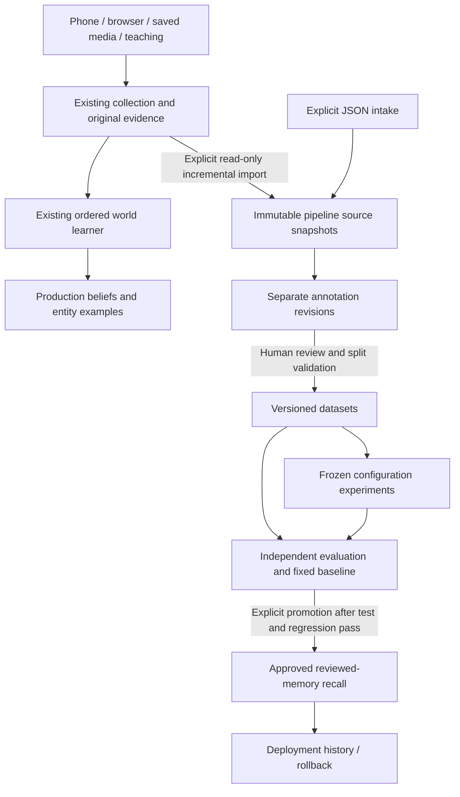

# Collection, review, experiments and deployment

This is an additive workflow around the existing [world model](WORLD_MODEL.md), not a replacement implementation plan. The online learner still assesses surprise before learning and keeps its transactional world updates. The pipeline provides independent source collection, annotation, reproducible dataset preparation, configuration experiments, evaluation, and explicit deployment of **reviewed-memory recall**. No custom neural training is currently justified by the available labels or accepted benchmarks.

## Existing responsibilities and new boundaries

| Stage | Existing implementation | Added responsibility |
|---|---|---|
| Collection | Phone/browser/file adapters, original recordings, observation receipts, immutable teaching | `pipeline/collection.py`: incremental read-only import and explicit JSON intake, immutable source snapshots, fingerprints, checkpoints and failure records |
| Interpretation | Local DINO/SAM/Whisper, optional `DialogueAdapter`, world sensing and fallible teaching | `pipeline/labeling.py`: deterministic suggestions, machine/human origin, explicit human review, independent revision history |
| Dataset preparation | Disposable fixtures and local replay scripts | `pipeline/datasets.py`: reviewed snapshots, source/label versions, duplicate/conflict reporting, persistent split ownership |
| Model development | Pretrained local models; deterministic online learning rules | `pipeline/experiments.py`: frozen lexical retrieval configurations, source-code fingerprints, environment and dataset identity; no training job |
| Evaluation | World acceptance tests, `world_smoke.py`, place/session replay | `pipeline/evaluation.py`: independent gold cases, fixed baseline, per-case evidence and metrics, timing/resource records |
| Production | World beliefs/entities and their revision histories | `pipeline/deployment.py`: explicit evaluated recall configuration, append-only promotion/rollback, source exclusion checks |
| Visibility | Existing Mac console and paired API | Dedicated `web/src/app/workspaces/` routes, retained `PipelinePanel.tsx`, `/api/v2/pipeline`, `python -m grounded_memory.pipeline` |



The pipeline never opens the live memory database for writing, invokes the online engine, edits beliefs, rebuilds entity examples, or loads inference weights. The paired API opens a separate ledger; all pipeline domain operations also work with the CLI without starting the app. Existing source-adapter failures remain in their existing session events/phone outbox; pipeline-stage failures have a separate history.

## Ownership and lifecycle

- Original recordings, assets, source timestamps, sensor IDs, existing observations and teaching remain owned by the existing capture/world repositories under `GM_DATA_DIR`. Nothing here deletes them.
- Pipeline data lives in `GM_DATA_DIR/pipeline/pipeline.sqlite3`, using SQLite transactions. Raw snapshots, labels, datasets, experiment runs, evaluations, deployments and failures are append-only. Checkpoints and current exclusion policy are transactional mutable bookkeeping.
- Imported observations may already contain **derived perception fields**. The importer preserves the saved envelope and records the source table/origin; it does not pretend those features are raw camera pixels or independent teaching. Original media references stay in the payload and are not copied.
- Import reads existing `observations`, `world_observations`, `world_teachings`, and legacy `utterances` tables. It never creates or migrates the source database. It imports immutable retained records by row ID; it is not a sync mechanism for mutable beliefs/entities or arbitrary external connectors. Teaching lineage follows question/observation references back to episode, recording, sample and asset groups. Legacy utterances without session identity are conservatively kept in one unresolved family, with available asset lineage retained.
- A label points to one source and the previous label revision. Human review is fallible testimony, not a guarantee. Only a human-method revision can set `reviewed=true`. A reviewed label on model/playback-derived raw input still cannot supply independent dataset evidence.
- Each dataset pins exact source fingerprints, annotation revisions, transformation version, assignments, evaluation cases and fixed evaluation time. Repeating preparation with identical inputs returns the same dataset ID, even in a fresh ledger with the same inputs. Label corrections create a different dataset version.
- Experiments produce configurations and evaluation artifacts, never production memory writes. Every run has a fresh ID; repeated evaluation keeps both results. A semantic result digest excludes variable timing measurements.
- The current retrieval implementation scans the approved immutable dataset; it has **no separate derived index to rebuild**. Preparing and evaluating a new dataset is the rebuild path. Existing world indexes/examples retain their original lifecycle.
- Changing a label or excluding a source invalidates any dataset using it for experiments, promotion, rollback and recall. Recall fails closed with an actionable error. Reprepare and reevaluate before replacing the deployment; old artifacts remain inspectable.

Back up the full data directory with services stopped, including the pipeline ledger and media. To run unrelated research, use a separate `--root` directory. Do not copy personal experiments into Git.

## Inspection and collection

From the repository root:

```sh
make pipeline-smoke
make pipeline ARGS='status'
uv run --no-sync python -m grounded_memory.pipeline --help
```

The smoke prints three `PASS` lines using synthetic fixtures in a temporary directory and cleans up afterward. It does not deploy anything to your actual data directory.

Start with `make dev`, pair, and open **Collection** at `/collection`. **Collect saved inputs now** runs one bounded import; optional automatic import checks every ten seconds while that page remains open. Source preferences persist for HTTP imports; CLI import retains its all-source default. Separate `/labeling`, `/datasets`, `/experiments`, `/evaluation` and `/deployment` workspaces support the complete workflow without terminal commands. The original console and panel remain at `/capture`. See [Applications](APPLICATIONS.md) for the user guide, architecture and limits. Opening workspaces is read-only; opening a review can create an explicitly unreviewed suggestion.

Equivalent collection/inspection commands:

```sh
uv run --no-sync python -m grounded_memory.pipeline import \
  --source "$HOME/Library/Application Support/Grounded Memory" --limit 500
make pipeline ARGS='list raw'
make pipeline ARGS='list failure'
```

Adjust `--source` when using `GM_DATA_DIR`. The default ledger follows `GM_DATA_DIR`; `--root` explicitly overrides it. Repeated import resumes after its checkpoint. An imported record and its checkpoint commit together. `more_may_remain=true` means run another batch; a final zero-import batch is harmless. Source identities are namespaced by the source database's resolved path, so moving a source database is a new import identity. Do not move databases casually; dataset content/fact checks still guard duplicate evidence.

Explicit intake uses `collect input.json`. For example, `input.json`:

```json
{
  "id": "note:toolbox:1",
  "source_id": "document:toolbox-notes",
  "source_kind": "user-note",
  "source_timestamp": 1794268800,
  "group_ids": ["document:toolbox-notes"],
  "origin": "human",
  "payload": {"text": "The hex key is in the toolbox."}
}
```

Duplicate IDs with identical content are idempotent; changed content under the same ID is rejected and logged. Fingerprints also detect duplicate content during dataset preparation. Collection alone never becomes trusted recall memory.

## Labeling and correction

```sh
make pipeline ARGS='suggest note:toolbox:1'
make pipeline ARGS='get note:toolbox:1'
make pipeline ARGS='list annotation'
uv run --no-sync python -m grounded_memory.pipeline label note:toolbox:1 label.json
```

`suggest` copies available source text/metadata into an **unreviewed** deterministic annotation and does no model inference. Existing local interpretation can supply a proposal with `method=model`; the pipeline stores it as unreviewed. There is no new automatic model-labeling worker.

`label.json` (use the actual latest annotation ID returned by `suggest`/`list`; use null for a source without any annotation):

```json
{
  "actor": "local-reviewer",
  "method": "human",
  "reviewed": true,
  "text": "The hex key is in the toolbox.",
  "fact_keys": ["hex-key:location"],
  "status": "current",
  "valid_from": 1794268800,
  "valid_until": null,
  "previous_revision": "annotation:REPLACE_WITH_LATEST_ID"
}
```

The previous revision must match; stale edits cannot silently replace a newer review. Validity boundaries are epoch seconds, inclusive start/exclusive end. `historical`, `contested`, and `excluded` are also supported statuses. Use the same fact key for different statements about the same underlying fact; this enables conflict inspection and leakage prevention. Use explicit group IDs for conversations/documents shared across source adapters.

## Prepare datasets without recollecting

Save a dataset specification as `dataset.json`, then run:

```sh
uv run --no-sync python -m grounded_memory.pipeline prepare dataset.json
```

Minimal specification (enough to inspect a dataset, deliberately insufficient for promotion):

```json
{
  "name": "toolbox-review-v1",
  "purpose": "reviewed-local",
  "reviewer": "local-reviewer",
  "evaluation_time": 1794355200,
  "assignments": {"note:toolbox:1": "validation"},
  "cases": [{
    "id": "where-is-hex-key",
    "split": "validation",
    "query": "hex key",
    "expected_ids": ["note:toolbox:1"],
    "categories": ["accuracy", "retrieval", "grounding"],
    "group_ids": ["document:toolbox-notes"]
  }]
}
```

Use distinct `train`, `validation`, `test`, and `regression` groups as the dataset grows. Expected evidence must belong to the query's split. Empty expected IDs represent an unanswerable or access-denied query. Cases can set `as_of`, `allowed_sources`, `include_history`, `expected_uncertain`, and `expected_hit_count`. Do not label one trivial example as all seven categories to obtain a passing gate; gold cases require meaningful human review.

The complete fixed synthetic suite is `tests/fixtures/pipeline/regression-v1.json`: separate training/validation examples and seven cases each for test and regression. It covers current/past facts, uncertainty, cross-source retrieval, exact duplicate consolidation with all citations, unknown questions, and source exclusion. Keep v1 stable; make a separately named fixture for a deliberate benchmark revision. This is a behavioral regression set, **not a real-world accuracy estimate**.

Preparation rejects overlap in declared source/conversation/document groups, fact keys, exact normalized text, raw payload hashes, or normalized query text. Split ownership persists across dataset versions in the same ledger, preventing a final-evaluation fact from later entering training. Related records remain in one split, even when that makes the dataset too small. Unknown paraphrases and undeclared shared facts cannot be discovered reliably; the reviewer must supply their lineage. Do not create another ledger simply to bypass held-out ownership.

Duplicate statements and possible conflicts/temporal changes are reported in the dataset warnings. They are preserved for explicit review, not silently deleted or resolved. Different validity intervals or competing testimony can be intentional.

## Experiments, evaluation and promotion

Use only train/validation material to choose a configuration. Freeze the candidate **before** inspecting final test/regression results. The tool enforces artifact identity and source partitioning; it cannot prevent a person from manually tuning to published test answers.

Save `strategy.json`:

```json
{"algorithm": "coverage", "top_k": 3, "min_score": 0.5}
```

Then use the IDs printed by each command:

```sh
uv run --no-sync python -m grounded_memory.pipeline experiment DATASET_ID --config strategy.json
uv run --no-sync python -m grounded_memory.pipeline evaluate EXPERIMENT_ID --split validation
uv run --no-sync python -m grounded_memory.pipeline evaluate EXPERIMENT_ID --split test
uv run --no-sync python -m grounded_memory.pipeline evaluate EXPERIMENT_ID --split regression
uv run --no-sync python -m grounded_memory.pipeline promote EXPERIMENT_ID TEST_EVALUATION_ID REGRESSION_EVALUATION_ID --actor local-reviewer
uv run --no-sync python -m grounded_memory.pipeline recall 'hex key'
uv run --no-sync python -m grounded_memory.pipeline rollback PREVIOUS_DEPLOYMENT_ID --actor local-reviewer
```

Supported algorithms are token-set intersection/union (`overlap`, the fixed baseline) and query token coverage (`coverage`). Both are deterministic and dependency-free. No confidence calibration, training, cloud service, paid inference, or weight download is implied. Existing DINO/SAM/Whisper/LM Studio usage remains unchanged.

Evaluation records precision, recall, exact evidence-set match plus expected uncertainty/consolidation checks, category scores, full results, elapsed time, process CPU time and process-lifetime peak RSS (platform units are recorded). These are **extractive retrieval metrics**, not a semantic truth oracle or a benchmark of generated prose. Evaluation time is pinned in the dataset; production current-time recall uses the actual time. `--as-of` allows historical recall.

The experiment fingerprints the actual backend source bytes, including uncommitted work, and records Python/platform/SQLite versions. A code change requires a new candidate and evaluation. Dependency/environment versions are recorded rather than automatically enforced; reproducibility still requires the locked environment. Raw inputs and artifact JSON are available through `get ID` or the paired API's `/artifact?id=ID`.

Final evaluation checks both the split-specific corpus and the **full frozen corpus used by deployed recall**, so unrelated records cannot sneak through when splits are combined at serving time. No fitting occurs during either check. Promotion requires:

1. Test and regression evaluations from exactly the candidate/dataset being promoted.
2. All seven categories in both final suites: accuracy, retrieval, temporal, contradiction, consolidation, grounding, privacy.
3. All curated cases pass, both within split and against the deployment corpus; precision/recall/exact scores do not fall below the fixed baseline.
4. Source labels/policies and running source code still match the evaluated snapshot.
5. An explicit promote action with a named local actor.

This gate intentionally demands complete behavioral regression success; statistical acceptance thresholds for real field data require a separate reviewed benchmark. Synthetic promotions are visibly marked. The smoke promotes only within a temporary ledger. No live deployment is performed merely by preparing data or creating candidates.

Rollback appends a pointer to a previously approved artifact, preserving the intervening deployment history. It does not rewrite source data, memories or evaluation results. A stale/excluded source or different running code blocks rollback; restore compatible code or reevaluate an eligible snapshot first.

## Privacy, automation, and recovery

All HTTP pipeline routes use the existing pairing cookie. This remains a local single-user application, not a multi-user authorization system. `allowed_sources` is an additional narrowing filter, never a way to bypass an exclusion. CLI access uses operating-system access to the data directory. Inputs and artifacts stay local.

```sh
uv run --no-sync python -m grounded_memory.pipeline exclude RECORD_ID --actor local-reviewer
uv run --no-sync python -m grounded_memory.pipeline exclude RECORD_ID --actor local-reviewer --restore
make pipeline ARGS='list failure'
```

Exclusion blocks downstream use, including existing deployed snapshots, but keeps originals and audit history. It is **not physical erasure** of private content from artifacts/backups. There was no existing hard-delete/retention workflow to preserve; a complete purge mechanism requires explicit lifecycle design across recordings, world memory, pipeline snapshots and backups. Do not use exclusion as a promise of deletion.

Existing capture/online perception remains automatic. Pipeline import is explicitly triggered, bounded and incremental; suggestions are cheap and repeatable. Dataset preparation, evaluation, promotion and rollback are explicit. There are no background polling jobs, model retraining jobs or idle model loads. The console fetches on opening, changing stage/page, refreshing or completing an action.

On failure, inspect the stage's failure record, correct the input and rerun just that stage. A successful retry does not erase the failure history. Schema-invalid API requests are rejected before entering a stage; entered-stage exceptions are logged. A corrupt/missing source database cannot be created accidentally by the importer. Failed dataset preparation rolls back its group reservations; failed promotion leaves the existing deployment active. Stop services before restoring a full backup; inspect a restored copy in a separate directory first.

## Limits and next measurements

- Capture and online world learning remain coupled intentionally for real-time surprise/prediction ordering. Pipeline intake is independent, but this change does not defer every online observation to a manual-label queue.
- The new recall path is supplementary. It does not change localization thresholds, acoustic recognition, world consolidation, pretrained embeddings, prompts, or existing `/api/memory` behavior. Those require adapter-specific replay/evaluation before future promotion support.
- Labeling supports deterministic suggestions, stored model proposals, and human confirmation. There is no automatic semantic annotation model or synonym/contradiction solver.
- Consolidation only merges identical normalized statements with the same status and validity, preserving all citations. Shared fact keys expose possible disagreements; this is not general temporal/causal reasoning.
- Private-data import validates source compatibility and integrity, not factual accuracy. Existing real place/session replays and physical iPhone acceptance remain in [NEXT_STEPS](NEXT_STEPS.md).
- Large-corpus retrieval currently scans an immutable snapshot. Measure latency and memory before introducing an index. The next useful optimization, if measured necessary, is a versioned lexical index built from the same reviewed snapshot, checked against this baseline.
- The first substantive next dataset is a manually reviewed, source-grouped set of real teaching outcomes. Do not reuse the same rooms/sessions/facts for both tuning and claims of final accuracy. Custom ranking or calibration training should wait for that dataset and a demonstrated baseline failure.
